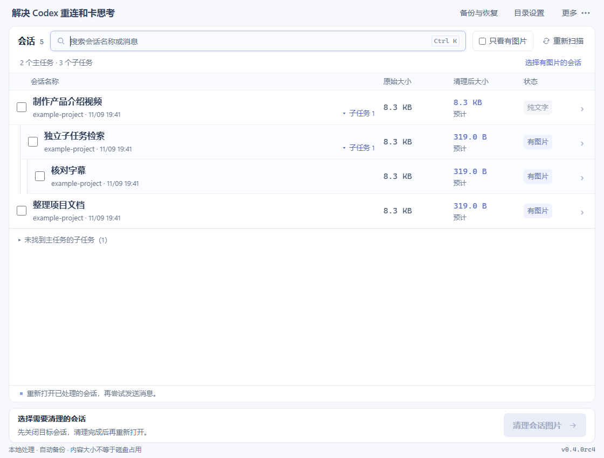

# Fix Codex reconnects and stuck thinking

[简体中文](README.md) · **English**

**Codex Image Cleaner provides a way to try recovering conversations that repeatedly reconnect or remain stuck thinking: remove historical image context, then reopen the conversation.**

It targets conversation history containing screenshots, image inputs, or generated images. Text, code, and original image files are preserved. Everything runs locally, with automatic backups and restore support.

You can select and clean conversations while the scan is still running. When a conversation lock is detected, supported desktop installations offer automatic Codex shutdown and restart after processing. A result dialog shows content sizes before and after cleanup and the outcome for each conversation.

## Download

| Platform | Download |
| --- | --- |
| Windows 10/11 x64 | [Windows](https://github.com/0xsuannai/codex-image-cleaner/releases/download/v0.4.0rc4/codex-image-cleaner-0.4.0rc4-windows-x64.zip) |
| Mac · Apple Silicon | [M-series](https://github.com/0xsuannai/codex-image-cleaner/releases/download/v0.4.0rc4/codex-image-cleaner-0.4.0rc4-macos-arm64.zip) |
| Mac · Intel | [Intel](https://github.com/0xsuannai/codex-image-cleaner/releases/download/v0.4.0rc4/codex-image-cleaner-0.4.0rc4-macos-x86_64.zip) |

Extract and run `CodexImageCleaner.exe`, or move the `.app` into Applications and open it. Python is bundled; a modern browser is required. This is a release candidate. Mac builds are verified on macOS 15 and are not Apple-notarized. The application UI is currently Simplified Chinese.

[All releases and checksums](https://github.com/0xsuannai/codex-image-cleaner/releases)

## What to do when Codex reconnects or stays stuck thinking

1. Open the cleaner, search for the conversation, or filter to conversations with images.
2. Select the target and click **清理会话图片** (clean images). You can do this before the full scan finishes; selected conversations are checked first.
3. Confirm the names. If a lock is detected, save your work and stop tasks, then use automatic Codex shutdown and restart when available. You can also close conversations manually.
4. Check the result dialog, reopen the cleaned conversation, and send a short message to see whether reconnecting or stuck thinking has improved. If automatic restart was selected, wait for Codex to restart first.
5. To undo cleanup, use **备份与恢复** (backups and restore).

The default conversation home is `~/.codex` or `CODEX_HOME`; change it in directory settings. If online locking is incompatible, fully exit Codex and its IDE extensions, then choose offline processing.

## Before you use it

- Cleaning historical image context is a recovery attempt, **not a guaranteed fix for every reconnect or stuck-thinking issue**. Network, proxy, and backend problems require separate troubleshooting.
- This reduces image context, **not disk usage**.
- Restore refuses to overwrite messages added after cleanup. After an interruption, use the repair action first.
- This is an independent tool, not an official OpenAI product. Backups contain conversation data; keep them private.

[Usage and compatibility](docs/guide.md#english) · [Issues](https://github.com/0xsuannai/codex-image-cleaner/issues)

[MIT License](LICENSE) · [Security](SECURITY.md)
