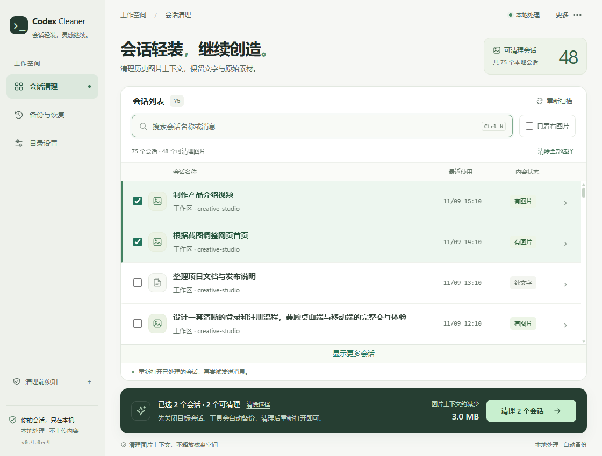

# 解决 Codex 重连和卡思考

**简体中文** · [English](README.en.md)

**Codex Image Cleaner：遇到 Codex 反复重连、一直卡在“思考中”，可以尝试清理会话里的历史图片上下文，再重新打开会话继续工作。**

本工具面向含有截图、识图或生成图片记录的历史会话，提供“清理图片上下文 → 重新打开会话 → 检查是否恢复”的处理流程。保留文字、代码和原始图片文件，全部本地处理，修改前自动备份，支持恢复。

无需等全部扫描结束，选中目标会话即可清理。检测到会话锁时，可一键关闭 Codex，处理结束后自动重启；结果弹窗展示清理前后的内容大小和逐项处理结果。

## 下载

| 系统 | 下载 |
| --- | --- |
| Windows 10/11 x64 | [Windows 版](https://github.com/0xsuannai/codex-image-cleaner/releases/download/v0.4.0rc4/codex-image-cleaner-0.4.0rc4-windows-x64.zip) |
| Mac · Apple Silicon | [M 系列芯片版](https://github.com/0xsuannai/codex-image-cleaner/releases/download/v0.4.0rc4/codex-image-cleaner-0.4.0rc4-macos-arm64.zip) |
| Mac · Intel | [Intel 版](https://github.com/0xsuannai/codex-image-cleaner/releases/download/v0.4.0rc4/codex-image-cleaner-0.4.0rc4-macos-x86_64.zip) |

解压后运行 `CodexImageCleaner.exe`，或将 `.app` 拖入“应用程序”后打开。无需安装 Python，需要现代浏览器。当前为候选版；Mac 以 macOS 15 验证，应用尚未做 Apple 公证。

[所有版本与校验文件](https://github.com/0xsuannai/codex-image-cleaner/releases)

## 重连、卡思考时怎么用

1. 打开工具，搜索会话，或勾选“只看有图片”。
2. 扫描过程中即可选择会话清理，无需等待全部扫描完成。尚未检查的选择会优先检查。
3. 核对名称。若检测到会话锁，先保存工作并停止任务，再选择“一键关闭 Codex，完成后自动重启”。也可手动关闭会话。
4. 清理完成后查看结果弹窗，确认处理成功。重新打开已清理的会话，发送一条简短消息，检查重连或卡思考是否缓解；选择自动重启时，等待 Codex 重新启动后再检查。
5. 需要撤销清理时，在“备份与恢复”中恢复。不再需要的备份可在此确认后永久删除，释放备份占用的空间。

默认读取 `~/.codex` 或 `CODEX_HOME`，可在“目录设置”中修改。在线锁机制不兼容时，完全退出 Codex（含 IDE 插件），再选择离线处理。

## 使用前了解

- 本工具通过清理历史图片上下文尝试恢复会话，**不保证解决所有重连或卡思考问题**。网络、代理或服务端问题仍需另行排查。
- 清理的是图片上下文，**不会释放磁盘空间**。
- 大小对比统计会话日志的有效内容，不包含为兼容历史位置保留的空白填充；磁盘文件大小另行显示，历史缓存减少量单列。
- 一键关闭与重启适用于可识别的 Windows / Mac Codex 桌面应用；CLI 和 IDE 插件需手动退出。退出失败时不会强制清理。
- 清理后若会话已有新消息，旧备份会拒绝覆盖。操作中断时，先使用“修复上次中断”。
- 本工具非 OpenAI 官方产品。备份包含会话内容，请勿公开上传。

[详细使用与兼容说明](docs/guide.md) · [反馈问题](https://github.com/0xsuannai/codex-image-cleaner/issues)

[MIT License](LICENSE) · [安全报告](SECURITY.md)
